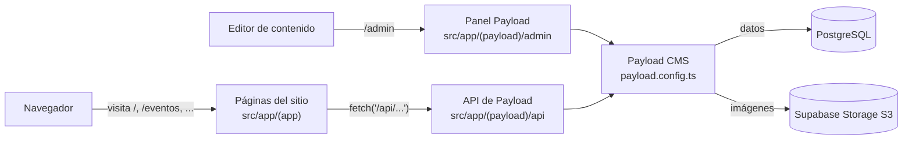

# NOVA web

Sitio web de **NOVA**, grupo estudiantil de tecnología e innovación de la Universidad EAFIT. Muestra quiénes somos, nuestros proyectos, eventos y la estructura del grupo. El contenido se administra desde un CMS (Payload) integrado en la misma aplicación de Next.js.

## Stack tecnológico

| Tecnología | Para qué se usa | Versión |
| --- | --- | --- |
| [Next.js](https://nextjs.org/) (App Router) | Framework web, rutas y servidor | 16 |
| [React](https://react.dev/) | Interfaz de usuario | 19 |
| [Payload CMS](https://payloadcms.com/) | CMS embebido: panel `/admin` y API REST/GraphQL | 3 |
| PostgreSQL (`@payloadcms/db-postgres`) | Base de datos del CMS | — |
| Supabase Storage vía S3 (`@payloadcms/storage-s3`) | Almacenamiento de imágenes subidas al CMS | — |
| `sharp` | Procesamiento de imágenes en Payload | 0.34 |
| [Tailwind CSS](https://tailwindcss.com/) + CSS propio | Estilos | 3 |
| [TypeScript](https://www.typescriptlang.org/) | Tipado | 5 |

## Requisitos previos

- **Node.js 20.9 o superior** (lo exige Next.js 16) y npm.
- Una base de datos **PostgreSQL** accesible (cadena de conexión).
- Un bucket de **Supabase Storage** con acceso S3 habilitado (para las imágenes).

## Puesta en marcha

```bash
git clone <url-del-repo>
cd NOVA-NOVAweb

# 1. Variables de entorno
cp .env.example .env.local   # y completa los valores (ver tabla abajo)

# 2. Dependencias
npm install --legacy-peer-deps

# 3. Servidor de desarrollo
npm run dev
```

- Sitio: <http://localhost:3000>
- Panel del CMS: <http://localhost:3000/admin> (la primera vez pide crear un usuario administrador)

> `--legacy-peer-deps` es necesario porque algunas dependencias de Payload declaran peer dependencies de versiones anteriores de Next/React.
>
> Las dependencias se instalan solo en la carpeta `node_modules/` del proyecto (no globalmente), así que funciona como un "entorno virtual". Para limpiar todo basta con borrar `node_modules/` y volver a ejecutar `npm install --legacy-peer-deps`.

## Variables de entorno

Se definen en `.env.local` (nunca subas este archivo con secretos; `.env.example` sirve de referencia).

| Variable | Descripción |
| --- | --- |
| `DATABASE_URI` | Cadena de conexión de PostgreSQL que usa Payload. **Obligatoria.** |
| `PAYLOAD_SECRET` | Cadena larga y aleatoria con la que Payload firma sesiones y tokens. **Obligatoria.** |
| `SUPABASE_S3_ENDPOINT` | Endpoint S3 de Supabase, p. ej. `https://<proyecto>.supabase.co/storage/v1/s3`. |
| `SUPABASE_S3_REGION` | Región del proyecto de Supabase. |
| `SUPABASE_S3_ACCESS_KEY_ID` | Access key S3 (Supabase → Storage → S3 Connection). |
| `SUPABASE_S3_SECRET_ACCESS_KEY` | Secret key S3. |
| `SUPABASE_S3_BUCKET` | Nombre del bucket donde se guardan las imágenes de la colección `media`. |

Si falta `DATABASE_URI` o `PAYLOAD_SECRET`, la app falla al arrancar (ver [payload.config.ts](payload.config.ts)).

## Scripts de npm

| Comando | Qué hace |
| --- | --- |
| `npm run dev` | Servidor de desarrollo con Turbopack y recarga en caliente. |
| `npm run build` | Compila la app para producción. |
| `npm run start` | Sirve la compilación de producción (requiere `build` antes). |
| `npm run lint` | Ejecuta el linter de Next.js. |

## Arquitectura y flujo de datos

Next.js y Payload viven en **la misma aplicación**. Payload se monta dentro de Next (vía `withPayload` en [next.config.ts](next.config.ts)) y expone el panel de administración y una API sobre la misma URL del sitio.



1. Un editor crea o edita contenido (eventos, proyectos, textos, imágenes) en `/admin`.
2. Payload guarda los datos en PostgreSQL y sube las imágenes a Supabase Storage.
3. Las páginas públicas son componentes cliente (`"use client"`) que, al cargarse, hacen `fetch` a la API REST de Payload (por ejemplo `/api/eventos`) y pintan el resultado.

La app se divide en dos **route groups** (las carpetas entre paréntesis no aparecen en la URL):

- **`src/app/(app)`**: el sitio público. Su [layout.tsx](src/app/(app)/layout.tsx) envuelve todas las páginas con `Navbar` y `Footer` y carga los estilos globales.
- **`src/app/(payload)`**: el panel `/admin` y las rutas `/api/*` de Payload. **Estos archivos los genera Payload; no los modifiques a mano.**

## Estructura de carpetas

```
NOVA-NOVAweb/
├── payload.config.ts        # Configuración de Payload: colecciones, globals, BD y S3
├── payload-types.ts         # Tipos TypeScript generados a partir del CMS
├── next.config.ts           # Config de Next (integra Payload, dominios de imágenes)
├── tailwind.config.ts       # Config de Tailwind
├── .env.example             # Plantilla de variables de entorno
├── public/                  # Imágenes estáticas (logos, títulos en SVG/PNG, mascotas, fondos)
└── src/
    ├── app/
    │   ├── layout.tsx       # Layout raíz mínimo
    │   ├── not-found.tsx    # Página 404
    │   ├── (app)/           # ── Sitio público ──
    │   │   ├── layout.tsx   # Navbar + Footer + fuentes + estilos globales
    │   │   ├── page.tsx     # Inicio (/)
    │   │   ├── Nosotros/    # /Nosotros
    │   │   ├── proyectos/   # /proyectos
    │   │   ├── grupo/       # /grupo
    │   │   ├── eventos/     # /eventos
    │   │   ├── home/        # /home (versión anterior de Nosotros)
    │   │   ├── auth/        # /auth/login y /auth/register (sin implementar)
    │   │   ├── dashboard/   # /dashboard (sin implementar)
    │   │   ├── components/  # Navbar, Footer, Carousel, UI/Button
    │   │   └── styles/      # globals.css, home.css, eventos.css
    │   ├── (payload)/       # ── Payload (autogenerado) ── /admin y /api/*
    │   ├── collections/     # Definición de colecciones del CMS
    │   └── globals/         # Definición de globals del CMS
    └── migrations/          # Migraciones de base de datos de Payload
```

## Páginas del sitio

| URL | Archivo | De dónde salen los datos |
| --- | --- | --- |
| `/` | [src/app/(app)/page.tsx](src/app/(app)/page.tsx) | Hero y Misión/Visión en el código; carrusel desde el global `home` (`/api/globals/home`) |
| `/Nosotros` | [src/app/(app)/Nosotros/page.tsx](src/app/(app)/Nosotros/page.tsx) | Global `nosotros` (`/api/globals/nosotros`) |
| `/proyectos` | [src/app/(app)/proyectos/page.tsx](src/app/(app)/proyectos/page.tsx) | Colección `proyectos` (`/api/proyectos`) |
| `/eventos` | [src/app/(app)/eventos/page.tsx](src/app/(app)/eventos/page.tsx) | Colección `eventos` (`/api/eventos`) |
| `/grupo` | [src/app/(app)/grupo/page.tsx](src/app/(app)/grupo/page.tsx) | Escrito en el código (junta, departamentos) |
| `/home` | [src/app/(app)/home/page.tsx](src/app/(app)/home/page.tsx) | Versión anterior de Nosotros; no aparece en el menú |
| `/auth/login`, `/auth/register`, `/dashboard` | `src/app/(app)/auth/…`, `src/app/(app)/dashboard/…` | Plantillas sin implementar |
| `/admin` | `src/app/(payload)/admin` | Panel de Payload |

El menú de navegación se define en el arreglo `links` de [Navbar.tsx](src/app/(app)/components/Navbar.tsx).

## Contenido en Payload CMS

Todo se edita desde `/admin`. Las colecciones y globals se declaran en [payload.config.ts](payload.config.ts) y tienen **lectura pública** (`read: () => true`), por eso las páginas las pueden consultar sin iniciar sesión.

**Colecciones** (listas de documentos) en [src/app/collections/](src/app/collections/):

| Slug | Archivo | Campos |
| --- | --- | --- |
| `eventos` | [Eventos.ts](src/app/collections/Eventos.ts) | `eventTitle` (texto), `eventDescription` (texto largo), `eventImage` (imagen de `media`) |
| `proyectos` | [Proyectos.ts](src/app/collections/Proyectos.ts) | `projectTitle`, `projectDescription`, `projectImage` (imagen de `media`) |
| `media` | [Media.ts](src/app/collections/Media.ts) | Archivo subido + `alt` (obligatorio). Se guarda en Supabase S3 |

**Globals** (un único documento editable) en [src/app/globals/](src/app/globals/):

| Slug | Archivo | Campos |
| --- | --- | --- |
| `home` | [Home.ts](src/app/globals/Home.ts) | `heroTitle`, `heroSubtitle`, `carouselImages` (varias de `media`) |
| `nosotros` | [Nosotros.ts](src/app/globals/Nosotros.ts) | `aboutText`, `historyText`, `historyImages` (varias de `media`) |

**Para añadir un campo o una colección nueva:**
1. Edita o crea el archivo en `collections/` o `globals/` y regístralo en `payload.config.ts`.
2. Crea y aplica una migración (ver abajo).
3. Regenera los tipos con `npx payload generate:types`.
4. Consume el dato desde la página con `fetch('/api/<slug>')` o `fetch('/api/globals/<slug>')`.

## API

Toda la API la genera Payload automáticamente (en `src/app/(payload)/api`); no hay endpoints propios:

| Endpoint | Descripción |
| --- | --- |
| `GET /api/eventos` | Lista de eventos (`{ docs: [...] }`) |
| `GET /api/proyectos` | Lista de proyectos |
| `GET /api/media` | Lista de imágenes |
| `GET /api/globals/home?depth=1` | Global de inicio; `depth` expande las relaciones (imágenes con su `url`) |
| `GET /api/globals/nosotros?depth=2` | Global de Nosotros |
| `POST /api/graphql` | API GraphQL |
| `GET /api/graphql-playground` | Explorador GraphQL (desarrollo) |

## Base de datos y migraciones

Payload usa PostgreSQL y guarda el historial de cambios del esquema en [src/migrations/](src/migrations/).

```bash
npx payload migrate:create <nombre>   # genera una migración a partir de los cambios en colecciones/globals
npx payload migrate                   # aplica las migraciones pendientes
npx payload migrate:status            # muestra qué migraciones se han aplicado
npx payload generate:types            # regenera payload-types.ts
```

En desarrollo, Payload también puede sincronizar el esquema automáticamente al arrancar. Antes de desplegar, crea siempre la migración correspondiente para que la base de producción quede igual.

## Despliegue

El proyecto se despliega en **Vercel**:

1. Configura en Vercel las mismas variables de entorno de `.env.local`.
2. Asegúrate de que el comando de instalación use `npm install --legacy-peer-deps`.
3. Aplica las migraciones pendientes contra la base de producción (`npx payload migrate`).
